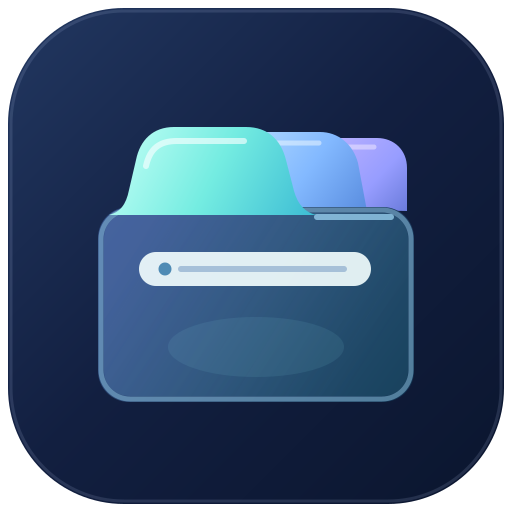

# Browser Mobile identity exploration — real browser tabs

**Status:** Founder-directed visual exploration. All assets remain **unapproved candidates**. The current canonical icon, Android source and installed application are unchanged by this draft.

## Current direction — Prism Tabs v3

On November 6, 2026, the founder clarified that Prism Tabs v2 looks like a **notepad or sketch icon**, not a browser. The next iteration must read as **real browser tabs**. Version 3 responds by changing the underlying silhouette—not just the finish.

**[Prism Tabs v3 · full-color app icon](prism-tabs-v3.svg)**

The new arrangement has three visible curved tab caps at the top, distinct inactive Iris/cobalt tabs, one selected Lagoon tab that joins a single browser canvas, a legible URL/address capsule beneath the tabs, and a deliberate empty viewing area. The notebook-like wavy page mark from v1/v2 is removed. The design uses the established Iris / Lagoon / navy direction without external artwork, scripts or fonts.

### Source studies

- [Prism Tabs v3 — full-color icon](prism-tabs-v3.svg): **primary review candidate**.
- [Prism Tabs v3 — transparent foreground](prism-tabs-v3-symbol.svg): a candidate header/adaptive-icon glyph without the outer tile.
- [Prism Tabs v3 — monochrome study](prism-tabs-v3-monochrome.svg): early Android themed-icon feasibility artwork. **Needs further development**; the overlapping cap outlines lose separation at small sizes and this is not an approved themed icon.
- [Prism Tabs v2](prism-tabs-v2.svg), [v2 transparent](prism-tabs-v2-symbol.svg), [v2 monochrome](prism-tabs-v2-monochrome.svg), [Prism Tabs v1](prism-tabs.svg): retained for provenance and direct comparison, **not preferred**.
- [Aurora Horizon](aurora-horizon.svg) and [Facet Portal](facet-portal.svg): first-round alternatives retained, but the founder asked to continue improving Prism Tabs.

### Practical design review

The color v2 and v3 source SVGs were rendered locally with the pinned `sharp` dependency at **128px, 48px and 32px**. V3 retains the active/inactive tab distinction at 128/48px and the tab-strip silhouette and address bar remain visible at 32px. Transparent and monochrome v3 studies were also rendered at those sizes. The monochrome study is **not** visually accepted; small-sized contours still need adjustment. No raster review files are committed, and no AI image-generation service is used.

These are source-only candidate graphics. This internal legibility check is not founder aesthetic approval, Android adaptive-mask verification, accessibility acceptance, app installation or a Stable product release.

## Acceptance gates

1. Founder reviews the v3 **browser-tab silhouette** and confirms whether it is sufficiently browser-like or requests another revision.
2. Refine the monochrome foreground; test Android mask/theme behavior with real launcher renders at 24/32/48/128px and light/dark modes.
3. Design a coordinated central **master icon, transparent header symbol, and light/dark wordmarks** from the accepted geometry. Preserve original and rejected work in git history.
4. Pin the approved central identity in `GoreeCloud/browser-mobile`, implement adaptive/monochrome launcher and header vectors, then run Android builds, unit tests, Lint and actual-device visual inspection.
5. Only after verified founder acceptance promote to canonical brand sources and synchronize the required project records. Do not merge this draft merely because CI checks pass.

**Explicit boundary:** This branch and PR must remain draft and unmerged. No existing icon or production artwork is overwritten by this exploration.
