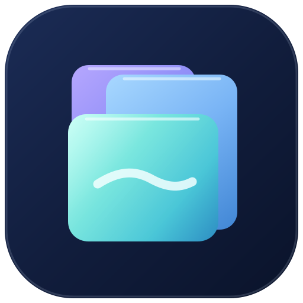

# Browser Mobile identity exploration — Prism Tabs refined

**Status:** Founder-selected *direction* for further improvement, **not final approval**. All assets here remain unapproved candidates. The current canonical Android icon and the product's launcher assets have **not** been replaced by this draft.

## Refinement requested

On November 6, 2026, the founder expressed a preference for an **improved version of Prism Tabs**. This follows explicit rejection of the previous Browser Mobile ring-and-arrow logo. Rather than substitute another unreviewed official mark, this PR updates the concept for founder review.

## Primary concept: Prism Tabs v2

- **[Full-color candidate](prism-tabs-v2.svg)** — three precise layered browser-page surfaces, consistent curvature, slightly separated edges, quiet glass highlights, and a single broad horizon stroke; GoreeCloud Iris, sky blue, lagoon and midnight canvas.
- **[Transparent symbol study](prism-tabs-v2-symbol.svg)** — candidate for a header mark and icon foreground without a second rounded-square tile.
- **[Monochrome silhouette study](prism-tabs-v2-monochrome.svg)** — preliminary proof of feasibility for Android themed-icon treatment; **not production-approved**.

[Compare with Prism Tabs v1](prism-tabs.svg). The first concept's slanted panels and tiny front-page lines felt more like loose note cards. V2 gives the panes common geometry, more visual hierarchy, a readable foreground and clearer overlap at small icon sizes. Original v1 source is preserved for provenance and is not overwritten.

**Internal visual test:** color v1 and v2 were rasterized for comparison at **128px, 48px, and 32px** with the repo's pinned `sharp@0.34.5`. The refined color variant reads as layered pages down to 32px, though the transparent and monochrome variants still need Android device rendering and accessibility testing. Preview PNGs were deliberately not committed. No external images, icon packs, raster artwork, remote resources, AI-generated pictures, or font files are used.

## Other directions retained, not preferred

| Alternative | Source | Distinct tradeoff |
| --- | --- | --- |
| **Aurora Horizon** | [SVG](aurora-horizon.svg) | Expressive open-web ribbons, but more abstract and circular |
| **Facet Portal** | [SVG](facet-portal.svg) | Angular glass portal, crisp at tiny sizes, less directly connected to browsing |

## Acceptance criteria before promoting a new official identity

1. Founder reviews and explicitly accepts the improved Prism Tabs direction or requests another revision.
2. Produce a cohesive central SVG **app icon, transparent mark, light/dark wordmarks, and adaptive/monochrome Android derivatives** from the approved geometry. The studies in this branch are not canonical masters.
3. Confirm icon mask safety, 24/32/48/128px legibility, high contrast, dark/light mode and actual launcher/header appearance on Android devices.
4. Pin an accepted revision in `GoreeCloud/browser-mobile`; compile, lint, run tests and perform device checks.
5. Preserve product identity history and record precise source provenance and acceptance state. Do not confuse a passing SVG check with founder design approval or Stable release.

The founder's earlier rejection of the existing ring-and-arrow mark remains active. The candidate branch **does not alter Android source, the current brand master, main, or the installed application**.
