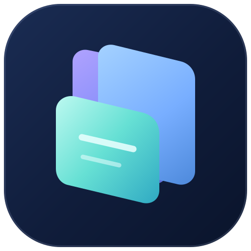
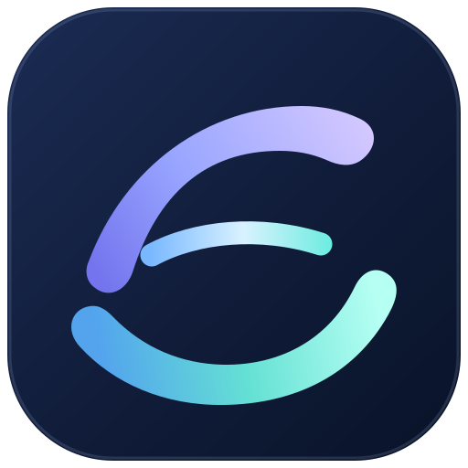
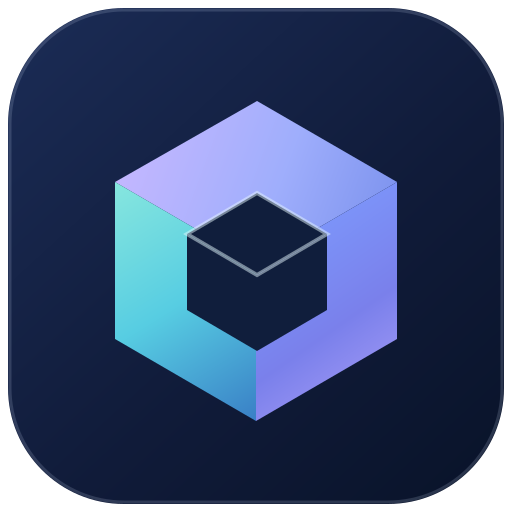

# Browser Mobile identity reset — founder review

**Status:** Three original design directions. **All are unapproved candidates. None is the official master or used by the Android application.**

**Reason:** On November 6, 2026 the GoreeCloud founder explicitly rejected the existing Browser Mobile ring-and-arrow logo after repeated unsuccessful iterations. Do not describe that icon as founder-approved or replace it blindly with another guessed final asset. Preserve its existing source provenance until a successor is selected and verified.

## Three distinct directions

| A — Prism Tabs | B — Aurora Horizon | C — Facet Portal |
| --- | --- | --- |
|  |  |  |
| [Source](prism-tabs.svg) | [Source](aurora-horizon.svg) | [Source](facet-portal.svg) |
| Layered, translucent web-page ribbons: most directly about tabs and browsing | Flowing horizon strokes: expressive, softer and less literal but potentially reminiscent of the rejected circular direction | Compact, geometric portal: simplest at small scale, but less literally recognizable as a browser |

### Art direction constraints

- Source all colors from the existing GoreeCloud UI **Iris / Lagoon / midnight canvas** vocabulary. No arbitrary third-party symbols, mascots, copied commercial browser marks, lettering or directional-arrow glyphs.
- Product-specific, original first-party SVGs; no remote resources, scripts, embedded images or web fonts. Background rounds follow the platform icon family.
- Avoid miniature browser chrome, tiny dots, detailed window frames and G-arrow emblems rejected in earlier rounds.
- The app needs a coordinated **icon + adaptive/monochrome launch glyph + header mark + light/dark wordmarks**, not a disconnected sticker.
- View both at 128px and 48px. These source vectors were locally rasterized for inspection on the authorized developer laptop; no preview PNGs were committed or shared in chat. No AI image-generation tool was used.

### Acceptance is pending

The founder may choose a candidate, give an alternative reference or reject all. None of those outcomes should be assumed. Before changing an app master: record the founder's selection; prepare and verify the coordinated central assets; protect source history; update Android VectorDrawables at a pinned identity revision; run Android build/Lint/tests and inspect an installed app on a device. Do not assert Play Store, multi-OEM or universal accessibility acceptance from vector-only checks.

**Current application:** [GoreeCloud/browser-mobile](https://github.com/GoreeCloud/browser-mobile) still contains the previously rejected icon. This candidate review intentionally changes no app code or installed launcher identity.
