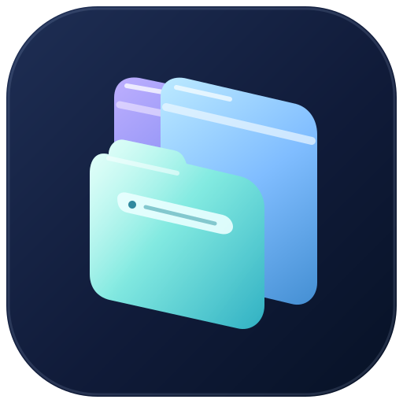

# Browser Mobile identity reset — Prism Tabs v5

**Review state:** Founder-preferred **Prism Tabs v1** is the explicit visual reference. The founder rejected the later v3/v4 browser-window look because it lost the essence of the original. **V5 is a fresh candidate, not an approved final identity.** No canonical master, Android application or installed icon was replaced.

## Current primary direction

**[Prism Tabs v5 — color concept](prism-tabs-v5.svg)** · [transparent foreground study](prism-tabs-v5-symbol.svg) · [monochrome study (not ready)](prism-tabs-v5-monochrome.svg)

### Return to what the founder liked

- Re-established the *original v1* composition: **three staggered, tilted translucent browser surfaces** on a midnight navy rounded square rather than one rectangular browser case with tiny tab bumps.
- Retained the original **Iris / sky blue / Lagoon** left-right-front hierarchy, soft luminous gradients, and overall diagonal visual rhythm.
- Made the tab/browser connection subtler: an integrated chrome strip along each rear glass surface and one clean URL capsule in the foreground. These are cues, not a full miniature desktop window.
- Removed the v3/v4 heavy body, the huge bright window and small browser-toolbar illustration that obscured the original look. Removed notebook-style lines, repeated page-rule details and extra inner cards.
- Enhanced depth using controlled glass highlights, rounded edges, shape separation and a single coherent foreground panel. No third-party logos, external fonts, image assets or AI image generation.

### Direct comparison and evidence

| Source | Assessment |
| --- | --- |
| **[Prism Tabs v1](prism-tabs.svg)** | **Founder-liked original direction**, preserved byte-for-byte for comparison. Distinctive colorful, diagonal glass panes, but the white strokes could resemble notepad lines |
| [Prism Tabs v2](prism-tabs-v2.svg) | Introduced regular rectangular panes; founder said it read as a notepad/sketch icon |
| [Prism Tabs v3](prism-tabs-v3.svg) | Made tab caps more literal, but turned the design into a tiny browser illustration |
| [Prism Tabs v4](prism-tabs-v4.svg) | Further simplified that illustration; founder said it no longer resembled the icon they liked |
| **[Prism Tabs v5](prism-tabs-v5.svg)** | **Fresh, v1-anchored redesign** with broad layered translucent glass and restrained browser cues; awaiting the founder's judgment |

The v1/v4/v5 SVGs were rendered locally at **128px, 48px, 32px and 24px** with the existing pinned `sharp` renderer, and the v5 transparent and monochrome studies were inspected at those sizes. V5 retains the three-color staggered silhouette at normal launcher resolutions; at 24px, individual details still collapse into a single colored cluster. The monochrome study looks more like outlined cards than clear tabs and **is not suitable for Android themed launcher use without redesign**.

### Acceptance and safety

This repository intentionally contains **proposals, not an official icon change**. Keep draft PR #9 open and unmerged; obtain founder visual feedback before any promotion. Then prepare coordinated master logo, adaptive/monochrome glyph, header mark, light/dark wordmarks, device-mask previews and Android application tests. Vector source and render checks do not certify taste, accessibility, launcher-mask safety, installed runtime quality, or Stable status.

No screenshot or AI-generated image has been added to the repository. Candidate SVG files are editable, original first-party source; review PNGs remain local to the authorized development computer.
